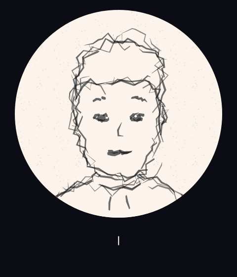
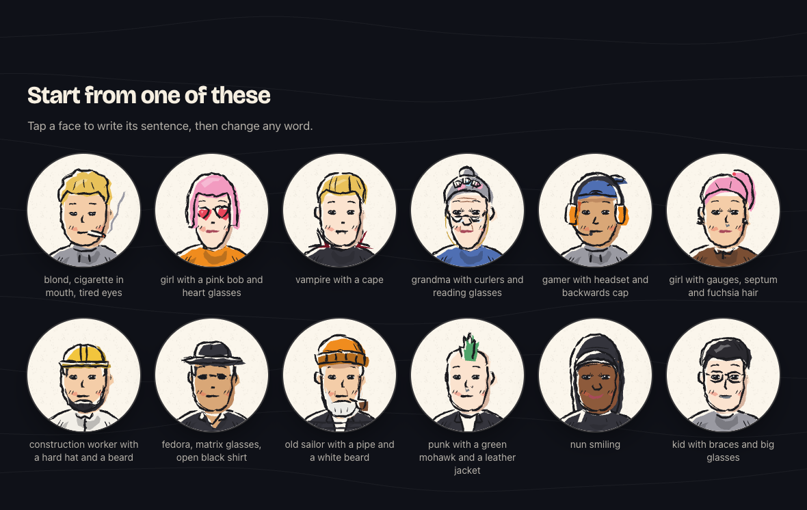

# Describble

**Describe someone. Watch them get drawn.** Try it at **[describble.com](https://describble.com)**.



Describble turns a sentence into a hand-drawn avatar while you type. Write `blond, cigarette in mouth, tired eyes` and a character appears on a round paper card, trembling while it figures you out, turning its head when something changes, settling when you stop. Download it, share the link, use it as your profile picture.

No AI. No account. No ads. It all runs in your browser, in English or Italian. The only thing that can leave your browser is an anonymous count of single words it did not understand, so it can learn them, and one click turns that off. See [PRIVACY.md](PRIVACY.md).

> Status: early, and growing fast.

## Why

Most avatar makers give you a random face or a long form of dropdowns. Describble works like describing someone to a friend who draws:

- **Just type.** The text box is the description. Delete a word and that piece disappears; `no glasses` works too.
- **See it being drawn.** Lines tremble while you type and calm down when you pause. New pieces are traced stroke by stroke.
- **Alive.** The head sways, glances aside when something new appears, and turns when you drag it.
- **Honest.** If it does not know a word, it says so.
- **Yours.** Every drawing is CC0: use your avatar anywhere, no credit needed.

## What it can draw



| Area | Examples |
|---|---|
| Faces | face shapes, noses, ears, eye shape and size, dimples, freckles, braces |
| Expressions | happy, sad, angry, tired, surprised, smug, blank stare, asleep, and blends of them |
| Hair | about 30 styles, from buzz cut and mullet to space buns and afro puffs, in any colour |
| Headwear | beanie, cap, hood, fedora, hard hat, graduation cap, hijab, veil, crown, cat ears… |
| Accessories | glasses, beards, headsets, scarves, piercings and gauges, a backpack, a stethoscope… |
| Clothes | hoodies, shirts, tracksuits, overalls, uniforms, with stripes, dots, flowers or plaid |
| Archetypes | one word sets several traits: `vampire`, `sailor`, `developer`, `gamer`, `grandma`, `punk`… |
| Brands | real brand names become a made-up logo, so no trademark ends up in your avatar |

## Run it

Node 20 or newer, no dependencies:

```bash
cd app
node build.mjs
open dist/index.html
```

`dist/index.html` is the whole website in one file: it works offline and straight from disk. `dist/chat.html` is an earlier chat version that also hosts the debug pages (`?mode=catalog`, `?mode=turn&say=…`, `?mode=misses`).

Run the tests with `node --test test/` from `app/`.

## How it works

```
text (every keystroke) → parser → state → scene → renderer → SVG
```

1. A rule-based **parser** maps words and short phrases to traits, handling plurals, typos, negations (`without`, `senza`) and colours attached to the nearest noun.
2. A pure **dialogue** module keeps the character's state and a confidence value for each trait.
3. Each **piece** is an original vector drawing on a 512×512 grid. Eyes and mouth are a small rig, so expressions can be blended.
4. The **renderer** breaks every curve into pen strokes, jitters them with a seeded random generator and boils between four variants. Each layer slides by a different amount when the head turns, which fakes depth.
5. Traits you do not mention come from a seed, so different people look different while yours stays stable as you type. The share link carries the sentence and the seed after the `#`, which never reaches a server.

More in [docs/ARCHITECTURE.md](docs/ARCHITECTURE.md); next steps in [docs/ROADMAP.md](docs/ROADMAP.md).

## Contributing

New words, new languages, new pieces and bug reports are all welcome. Adding a synonym is a one-line change, and [`app/lexicon-backlog.json`](app/lexicon-backlog.json) lists words people asked for that are still missing. Start with [CONTRIBUTING.md](CONTRIBUTING.md).

## License

- Code: [MIT](LICENSE)
- Drawn pieces and artwork: [CC0 1.0](LICENSE-ASSETS)
- Website typeface: Bricolage Grotesque, [SIL Open Font License](app/assets/fonts/OFL.txt)

Every piece is original. Describble does not include or trace third-party artwork, logos or existing characters. See [CONTENT_POLICY.md](CONTENT_POLICY.md).
